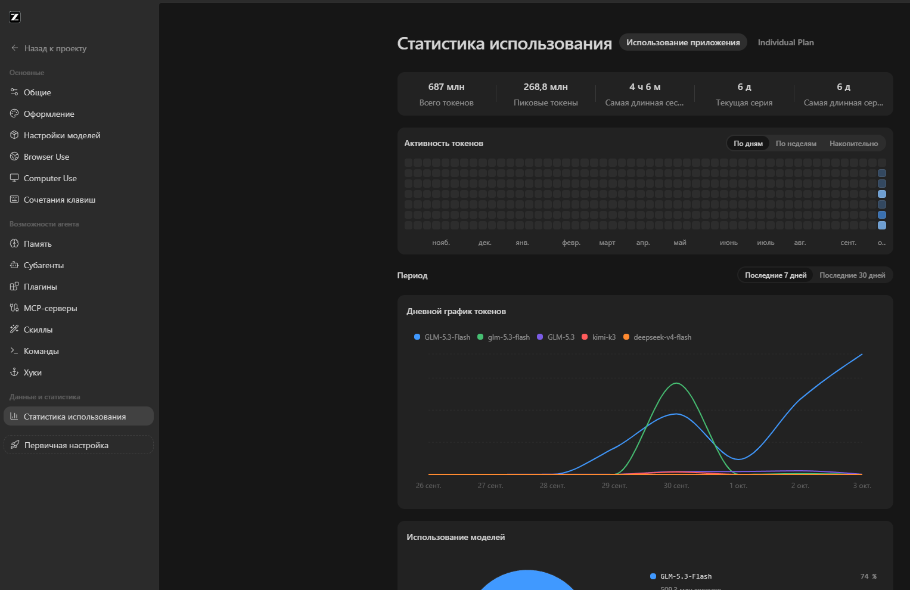
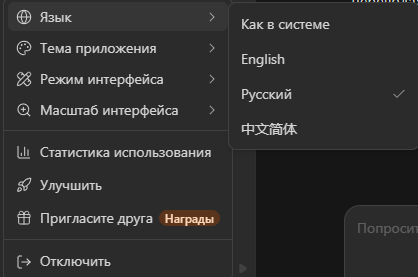

<div align="center">

# 🇷🇺 Русификация ZCode Desktop

### Russian UI localization for ZCode Desktop



**6 013 строк интерфейса · переключатель «Русский» в настройках · патчер с автотестом запуска и автооткатом**

[](https://z.ai)
[](#-русский)
[](translations/ru-RU-catalog.json)
[](LICENSE)

**[🇷🇺 Инструкция на русском](#-русский) · [🇬🇧 English instructions](#-english)**

</div>

---

## 🇷🇺 Русский

### Что это

**ZCode Desktop** (приложение Z.ai для работы с ИИ-агентами) официально
локализован только на английский и китайский. Этот проект добавляет
**русский язык** в интерфейс: меню, настройки, чат, диалоги, статистику —
всё становится русским, а в настройках появляется переключатель языка
с пунктом **«Русский»**.

В приложение уже встроена система локализации (react-intl) — но русского
каталога в ней просто не было. Патчер добавляет каталог из 6 013 переведённых
строк и регистрирует язык `ru` во всех местах, где приложение выбирает язык:
карта локалей, валидаторы, системный определитель, оба выпадающих списка
в настройках и даже экран критической ошибки.

> ✅ Проверено на **ZCode Desktop 3.14.4 и 3.15.1 (Windows 11)**, октябрь 2026.
> Скриншот выше — реальный интерфейс после установки.

<table>
<tr>
<td></td>
<td>Язык выбирается прямо в приложении — <b>Настройки → Язык → Русский</b>.<br><br>
Английский и китайский никуда не делись: переключайтесь в любой момент.
При «Как в системе» на русской Windows русский выберется автоматически.<br><br>
<sub>Language picker with the new «Русский» item (checkmarked). English and
中文简体 remain switchable at any time.</sub></td>
</tr>
</table>

### Требования

| Что | Где взять | Как проверить |
|---|---|---|
| Windows 10/11 | — | на macOS/Linux пути другие, см. «Ограничения» |
| Python 3.8+ | [python.org/downloads](https://www.python.org/downloads/) | `python --version` |
| Node.js 16+ | [nodejs.org](https://nodejs.org/) | `node --version` |
| Git (опционально) | [git-scm.com](https://git-scm.com/) | для `git pull` после обновлений |

Никаких платных инструментов; интернет нужен один раз — чтобы скачался
упаковщик `@electron/asar`.

### Установка в один клик (рекомендуется)

**Шаг 1.** Скачайте репозиторий: зелёная кнопка **Code → Download ZIP**,
распакуйте. (Или `git clone https://github.com/mdn77/zcode-translation-ru.git`.)

**Шаг 2.** Запустите **`install-ru.cmd`** двойным кликом.

Скрипт сам всё сделает: проверит Python и Node.js, обновит файлы (если это
git-клонирование), соберёт патч, закроет ZCode, установит, запустит приложение
и проверит, что окно открылось. Если что-то не так — вернёт оригинал обратно.
В конце появится надпись **DONE! / ГОТОВО!**.

**Шаг 3.** ZCode откроется с русским интерфейсом. Если нет — **Настройки →
Язык → Русский** (при русском языке Windows режим «Как в системе» сработает сам).

### Установка вручную (по шагам, если удобнее)

```cmd
cd zcode-translation-ru
python tool\apply_ru_patch.py          :: соберёт патч (2-4 мин), проверит синтаксис
tool\install_with_launchtest.cmd       :: закроет ZCode, поставит и проверит
```

- `apply_ru_patch.py` найдёт ZCode сам, **проверит синтаксис** пропатченных
  файлов (`syntax OK`) и создаст резервную копию. В конце подскажет, что файл
  готов в `resources\app.asar.new-ru`. Пока ZCode запущен, он держит файл —
  это нормально, установщик завершит подмену.
- `install_with_launchtest.cmd` закроет ZCode, поставит патч, **запустит
  приложение и проверит, что окно открылось**; не открылось — сам откатит.
  Отчёт: `C:\Users\<вы>\zcode-swap-result.txt`.

> Ручной вариант без установщика: закройте ZCode полностью (проверьте трей
> возле часов!) и запустите `python tool\apply_ru_patch.py` ещё раз — он
> подменит файл сам.

### После обновления ZCode ⚠️

**Обновления ZCode стирают русификацию** — это неизбежно, потому что новый
`app.asar` приходит целиком и заменяет пропатченный. Это ожидаемое поведение,
а не сбой. Лечится повторным запуском того же `install-ru.cmd` (или двух команд
из «Установки вручную»). Патчер ищет нужные файлы **по содержимому, а не по
имени**, поэтому сам находит новые версии чанков после апдейта.

Отдельная тонкость: ZCode скачивает обновление заранее и применяет его при
следующем перезапуске. Из-за этого патч иногда «исчезает» сразу после установки —
приложение перезапускается уже на новой версии. Установщик это учитывает:
перед установкой он удаляет скачанное, но не применённое обновление из кэша,
а после запуска сверяет размер `app.asar` с размером патча и сообщает, если
файл всё-таки был подменён.

### Откат на английский

Каждая установка создаёт резервную копию `app.asar.bak-<дата>` в папке
`resources`. Откат (ZCode будет закрыт скриптом автоматически):

```cmd
tool\swap_after_close.cmd "%LOCALAPPDATA%\Programs\ZCode\resources\app.asar.bak-20261003-050152"
```

(подставьте имя своего свежего бэкапа — они сортируются по дате в имени).

### Безопасность установки

Сломать приложение этой утилитой практически невозможно:

1. **Проверка синтаксиса** — оба пропатченных файла прогоняются через
   `node --check` (ESM) до упаковки. Невалидный патч не установится никогда.
2. **Верификация архива** — после пересборки сверяются маркеры патча,
   размер, состав записей и список нативных библиотек.
3. **Резервная копия** — создаётся перед каждой установкой.
4. **Защита от автообновления** — перед установкой удаляется скачанное,
   но ещё не применённое обновление ZCode (иначе оно затрёт патч при
   перезапуске), а после запуска размер `app.asar` сверяется с размером
   патча — подмена фиксируется и установка повторяется.
5. **Автотест запуска** — после установки скрипт запускает ZCode и ждёт
   35 секунд: нет окна — автоматический откат на оригинал и перезапуск.
6. **Ничего не удаляется** — патч только добавляет русский каталог и
   регистрирует язык; английский и китайский остаются на месте.

### Решение проблем

| Симптом | Причина и решение |
|---|---|
| Русский пропал после обновления ZCode | Ожидаемо: новый `app.asar` затёр патч. Запустите `install-ru.cmd` заново |
| Русский пропал сразу после установки | ZCode применил заранее скачанное обновление при перезапуске. Установщик уже чистит такой кэш — просто запустите `install-ru.cmd` ещё раз |
| Патчер пишет `app.asar not found` | Нестандартный путь установки. Укажите явно: `python tool\apply_ru_patch.py --asar "C:\путь\к\resources\app.asar"` |
| Патчер пишет `syntax check FAILED` | Точка патча изменилась в новой версии ZCode. Создайте issue с выводом скрипта |
| `install_with_launchtest` откатил установку | Смотрите причину в `%USERPROFILE%\zcode-swap-result.txt` |
| Пункта «Русский» нет в списке | Работает оригинальный `app.asar` — установка не завершена (ZCode блокировал файл). Запустите `install-ru.cmd` |
| Антивирус ругается на скрипты | Скрипты полностью открыты: .cmd/.py без сторонних загрузок, всё делает стандартный Python + официальный `@electron/asar` |

### Улучшение перевода

Перевод выполнен автоматически и наверняка местами шероховат:

1. Найдите строку по ключу в `translations/ru-RU-catalog.json`
   (например, `settings.plugins.*` — настройки плагинов).
2. Поправьте, сохраните в UTF-8.
3. Переустановите патч (см. «После обновления ZCode»).

PR с улучшениями очень приветствуются! Исходный английский каталог лежит
рядом (`en-US-catalog.json`), партии перевода — в `translations/batches/`.

### Ограничения

- Патчится только окно приложения; системные диалоги Windows (выбор файла)
  и CLI остаются на английском.
- Экран загрузки и пара служебных HTML-страниц не переведены.
- macOS/Linux: в патчере есть пути для этих ОС, но они не проверялись —
  используйте на свой страх (`python tool/apply_ru_patch.py` сам найдёт
  `/Applications/ZCode.app/...`).

### Как это работает (для любопытных)

Внутри `resources/app.asar` лежит весь интерфейс приложения. Патчер:

1. извлекает архив официальным `@electron/asar`;
2. находит по содержимому два файла: чанк `IntlProvider-*` (каталоги сообщений
   и логика выбора языка) и главный бандл рендерера;
3. добавляет в чанк русский каталог (переменная `__zcodeRuCat`), регистрирует
   `ru` в карте локалей `{"zh-CN":…,"en-US":…,"ru":…}`, валидаторах и системном
   резолвере, добавляет пункт «Русский» в два списка выбора языка;
4. в главном бандле подключает каталог импортом и переводит экран ошибки;
5. проверяет синтаксис обоих файлов через `node --check`, упаковывает архив
   обратно (нативные библиотеки node-pty/ssh2 остаются вне архива, как в
   оригинале), верифицирует и заменяет `app.asar`.

Весь процесс — 2–4 минуты, половина времени уходит на распаковку 27 000 файлов.

---

## 🇬🇧 English

### What is this

**ZCode Desktop** (the Z.ai AI-agent app) officially ships with English and
Chinese UI only. This project adds a **Russian language** option: menus,
settings, chat, dialogs and statistics become Russian, and a **«Русский»**
item appears in the app's language selector.

The app already has a full localization system (react-intl) — it just never
had a Russian catalog. The patcher injects a 6 013-string translated catalog
and registers the `ru` locale everywhere the app picks a language: locale map,
validators, system-locale resolver, both language dropdowns, and even the
crash screen.

> ✅ Battle-tested on **ZCode Desktop 3.14.4 and 3.15.1 (Windows 11)**, October 2026.
> The screenshots above are the real UI after installation.

### Requirements

- Windows 10/11 (macOS/Linux paths exist in the tool but are untested)
- [Python 3.8+](https://www.python.org/downloads/) — `python --version`
- [Node.js 16+](https://nodejs.org/) — `node --version`

### One-click install (recommended)

1. Download the repo (**Code → Download ZIP** and unpack, or
   `git clone https://github.com/mdn77/zcode-translation-ru.git`).
2. Double-click **`install-ru.cmd`**.

It checks Python and Node.js, refreshes the files (if a git clone), builds the
patch, closes ZCode, installs, relaunches and verifies the window appeared —
reverting automatically if not. Then open **Settings → Language → Русский**.

### Manual install (step by step)

```cmd
cd zcode-translation-ru
python tool\apply_ru_patch.py
tool\install_with_launchtest.cmd
```

Then ZCode restarts automatically → **Settings → Language → Русский**. Done.

What each step does:

1. `apply_ru_patch.py` finds your ZCode install automatically, extracts the
   archive with the official `@electron/asar` tool, locates the two JS chunks
   **by content** (so it works across app updates), injects the Russian
   catalog, and **syntax-checks the result with `node --check`** — an invalid
   patch can never be installed. The patched file is staged next to the
   original because running ZCode locks it.
2. `install_with_launchtest.cmd` closes ZCode, **deletes any downloaded but
   unapplied ZCode update from the updater cache** (otherwise it would
   overwrite the patch on restart), swaps the patched file in, launches the app
   and **verifies a window actually appears within 35 seconds, then checks the
   patched file is still in place; if not, it reverts to the original** and
   restarts ZCode. No way to brick the app.
3. A timestamped backup `app.asar.bak-<date>` is created before every install.

### After ZCode updates ⚠️

**ZCode updates wipe the patch** — the new `app.asar` arrives whole and
replaces the patched one. This is expected, not a failure: just run
`install-ru.cmd` again (or the two manual commands). The patcher locates the
chunks **by content**, so it finds the new version's files automatically.

One subtlety: ZCode downloads an update in advance and applies it on the next
restart, so a fresh patch can seem to "vanish" right after install. The
installer handles this: it clears the pending update cache first and verifies
the patched file survives the launch.

### Rollback

```cmd
tool\swap_after_close.cmd "%LOCALAPPDATA%\Programs\ZCode\resources\app.asar.bak-YYYYMMDD-HHMMSS"
```

Use the newest `.bak-…` file in the resources folder.

### Troubleshooting

| Symptom | Fix |
|---|---|
| Russian disappeared after a ZCode update | Expected — the update replaced the patched file. Run `install-ru.cmd` again |
| Russian disappeared right after installing | ZCode applied an update it had downloaded earlier. The installer already clears that cache — just run `install-ru.cmd` again |
| `app.asar not found` | Pass the path explicitly: `python tool\apply_ru_patch.py --asar "C:\path\to\resources\app.asar"` |
| `syntax check FAILED` | The patch point changed in a newer ZCode — please open an issue with the script output |
| Install was auto-reverted | See `%USERPROFILE%\zcode-swap-result.txt` for the reason |
| No «Русский» in the list | The original archive is still active — the final swap never happened; run `install-ru.cmd` |

### Repo layout

```
install-ru.cmd                      one-click installer (patch + install)
tool/apply_ru_patch.py              the patcher (Python + official @electron/asar)
tool/install_with_launchtest.cmd    install + launch test + auto-rollback
tool/swap_after_close.cmd           plain file swap helper
translations/ru-RU-catalog.json     Russian catalog, 6 013 strings
translations/en-US-catalog.json     original English catalog (reference)
translations/batches/*.json         per-batch translations (for improvements)
docs/screenshot-ru.png              real UI screenshot (usage stats)
docs/screenshot-language.png        language picker with «Русский»
```

### Notes

- Only the app window is localized; native OS file dialogs and the CLI stay
  English.
- The translation was produced automatically — polishing PRs are very welcome.
- Not affiliated with Z.ai. Use at your own risk; the tool creates backups
  and never deletes anything.

---

<div align="center">

**Лицензия / License:** MIT — [LICENSE](LICENSE)

</div>
